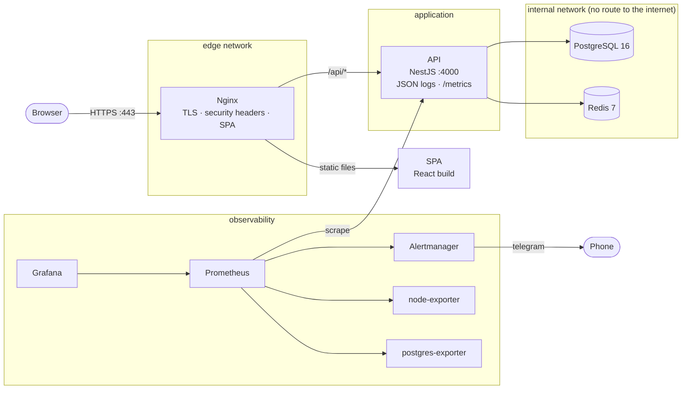
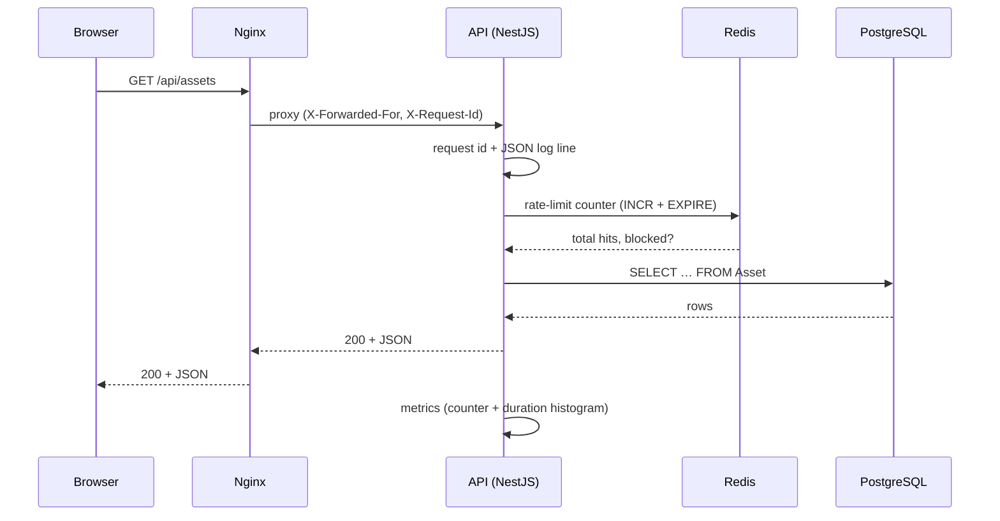
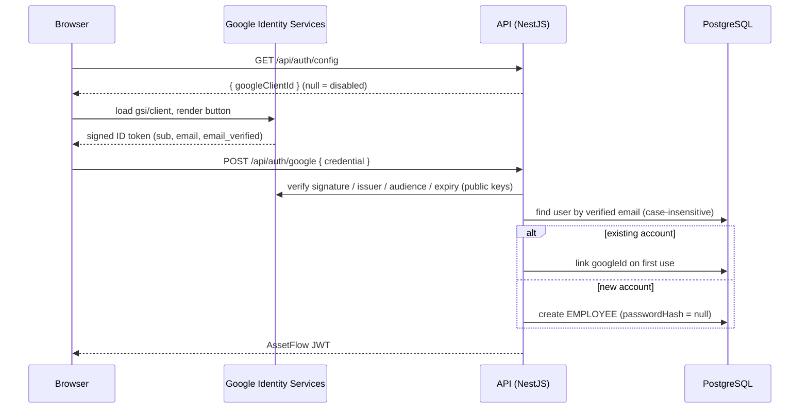
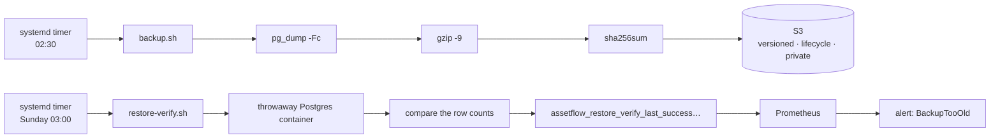
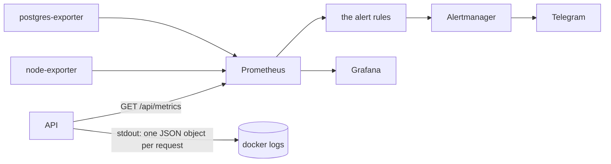

# The architecture of the self-hosted AssetFlow

> One Ubuntu host, several containers, one public entry point.
> The production deployment on Vercel (serverless) stays exactly as it is —
> this is the *self-hosted* variant, the one you can put on a VM and own.

## The big picture

## The request path

## Authentication, including Google

No client secret exists in the stack. The Google client id is public by
design; the security comes from verifying the token **server-side** and
requiring `email_verified`. A Google identity is linked to an existing
password account only when the verified email matches, so roles, allocations
and bookings survive the switch in sign-in method. `passwordHash` is nullable
and `googleId` is unique in the Prisma schema.

## The containers

| Container | Image | Published port | Why it exists |
|-----------|-------|-----------------|---------------|
| `nginx` | built from `infra/docker/Dockerfile.nginx` | 80, 443 | TLS (`infra/certs` bind-mounted), security headers incl. the Google CSP, the SPA and the only public entry point |
| `api` | built from `infra/docker/Dockerfile.api` | – (internal) | the NestJS application, non-root, with a health check |
| `postgres` | `postgres:16.4-alpine` | – (internal) | the database, on a network **without** a route to the internet |
| `redis` | `redis:7.4-alpine` | – (internal) | the shared rate-limit counters (see [DECISIONS](./DECISIONS.md#redis)) |
| `prometheus` | `prom/prometheus:v2.54.1` | 127.0.0.1:9090 | the metrics database and the alert rules |
| `grafana` | `grafana/grafana:11.2.0` | 127.0.0.1:3001 | the dashboard (reached through an SSH tunnel) |
| `alertmanager` | `prom/alertmanager:v0.27.0` | 127.0.0.1:9093 | groups the alerts and sends them to Telegram |
| `node-exporter` | `prom/node-exporter:v1.8.2` | – (internal) | CPU, memory, disk, network of the host |
| `postgres-exporter` | `prometheuscommunity/postgres-exporter:v0.15.0` | – (internal) | connections, transactions, locks |

## The networks

| Network | Containers | Internet? |
|---------|-----------|-----------|
| `edge` | nginx, api, prometheus, grafana, alertmanager, node-exporter | yes (the containers can reach the internet) |
| `backend` | api, postgres, redis, prometheus, node-exporter, postgres-exporter | **no** — `internal: true` |

The database and the cache are only reachable from the other containers. Even
a compromised API container cannot be used to expose the database to the
internet, and the database has no route out (which also means: no data
exfiltration through the database).

## The data flow of a backup

## The observability data flow

## What this design deliberately does **not** have

* no Kubernetes, no service mesh, no Terraform — a single host is enough for
  this workload and every extra layer is a thing to operate;
* no multi-AZ, no read replicas — the data fits on one volume;
* no secrets manager — the secrets live in `/opt/assetflow/infra/.env` with
  the file mode `600`, which is what a single host needs;
* no CDN and no WAF — the assets are hashed by Vite and cached by the browser;
* no PITR — the backups are logical dumps, so the worst case is the time
  since the last nightly backup (the RPO, measured in the DR drill).
